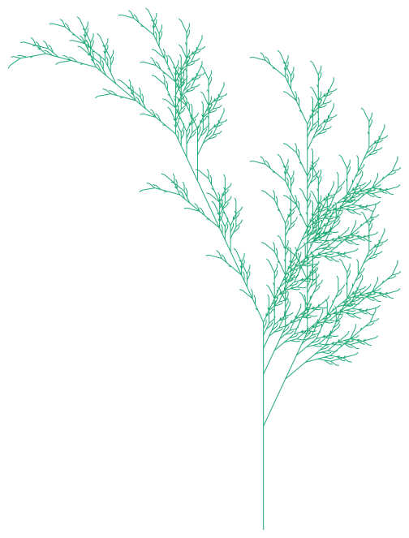

# 02. 同じ L-system レンダラーを Goose・Rust・C++ で書く

日付: 2026-10-28
Goose: v2026.3 / Rust: rustc 1.99.1 / C++: MSVC 19.44（VS 2022 Build Tools）
環境: Windows 11

## 作ったもの

L-system（文字列書き換え → タートルグラフィックス）で図形を描き、SVG に書き出すコマンドラインツールです。
`plant`、`koch`、`dragon`、`sierpinski` の4プリセットを持ち、引数で深さと出力先を受け取ります。

| 言語 | ソース |
|---|---|
| Goose | [experiments/svg-lsystem/goose/lsystem.goose](../experiments/svg-lsystem/goose/lsystem.goose) |
| Rust | [experiments/svg-lsystem/rust/src/main.rs](../experiments/svg-lsystem/rust/src/main.rs) |
| C++ | [experiments/svg-lsystem/cpp/lsystem.cpp](../experiments/svg-lsystem/cpp/lsystem.cpp) |

3つのプログラムは構造を揃えて書いてあります。関数の分け方（`rewrite` → `interpret` → `bounds` → `write_svg`）と出力フォーマットが同じなので、4プリセットすべてで3言語の出力がバイト単位で一致しました（`cmp` で確認）。

## 似ている部分、違う部分

同じ処理を3言語で並べたときの対応表です。「〜っぽい」は書いてみた印象です。

| 処理 | Goose | Rust | C++ | 印象 |
|---|---|---|---|---|
| 関数定義 | `fn rewrite(src: const u8[:], rules: const Rule[:], out: u8[>..]&)` | `fn rewrite(src: &[u8], rules: &[Rule], out: &mut Vec<u8>)` | `void rewrite(const std::string&, const std::vector<Rule>&, std::string&)` | 書き味は Rust。`const` の位置は C++ |
| 文字列 | `u8[>..]`（伸びるだけの u8 配列）。文字列型はない | `Vec<u8>` / `String` | `std::string` | Goose には文字列型がなく、全部 u8 配列。C の `char*` の感覚に近い |
| スライス | `u8[:]`。`line[..5]`、`grow[^2..]` | `&[u8]`。`&line[..5]` | `std::string_view` | `^k` で末尾から数える書き方は C# の index-from-end |
| 可変参照の引数 | `out: u8[>..]&`。呼び出し側は `rewrite(cur, rules, next)` と素のまま渡す | `out: &mut Vec<u8>`。呼び出し側は `&mut next` | `std::string& out` | 呼び出し側に印が要らないのは C++ の参照と同じ。Rust は `&mut` を明示 |
| 参照の束縛 | `let first .= items.push(...)`。`.=` で束縛、`=` でコピー、`.==` で同一判定 | `let first = &mut items[...]` | `Item& first = ...` | `.=` は Goose 独自。この3つの区別は最初に説明が要る |
| 構造体 | `struct Rule { from: u8, to: u8[..32] }` | `struct Rule { from: u8, to: &'static str }` | `struct Rule { char from; std::string_view to; }` | Goose の `u8[..32]` は容量32の配列が構造体の中に inline で入る。C の `char to[32]` に近いが長さを持つ |
| リテラル | `Rule { 'X', "F+[[X]-X]-F[-FX]+X" }`（位置指定）か `Preset { name: "plant", ... }`（名前指定） | `Rule { from: b'X', to: "..." }` | `{ 'X', "..." }` | 位置指定と名前指定の両方が使えるのは C++ の集成体初期化と Rust の構造体リテラルの両取り |
| 配列の種類 | `T[4]` 固定、`T[>..]` 伸びるだけ、`T[>..<]` 伸縮、`T[..8]` 容量付き inline、`T[]` 構築時に確定 | `[T; 4]`、`Vec<T>`、`Box<[T]>` | `std::array`、`std::vector` | 型名で「どう伸びるか」を宣言するのは Goose 独自。`T[>..]` は要素が移動しないので参照が無効にならない |
| スタック | `var stack: Turtle[>..<] = []; stack.push(t); t = stack.pop();` | `Vec<Turtle>` + `push` / `pop` | `std::vector` + `push_back` / `back` + `pop_back` | Rust と同じ感覚。`pop()` が値を返す |
| `match` | `match c { 'F', 'G' => { ... }, '+' => { ... }, _ => {}, }` | `match c { b'F' \| b'G' => { ... }, _ => {} }` | `switch (c) { case 'F': case 'G': ...; break; }` | 構文は Rust。複数パターンは `\|` ではなく `,`。腕に文を書くには `{}` が必須（式だけなら不要） |
| `if` 式 | `let kind = if hp > 50 { "healthy" } else { "hurt" };` | 同じ | 三項演算子 | Rust そのまま |
| 複数の戻り値 | `fn bounds(...) -> f64, f64, f64, f64` / `let minx, miny, maxx, maxy = bounds(segs);` | タプル `(f64, f64, f64, f64)` | 参照引数で返す | Goose はタプル型ではなく呼び出し規約。Go の多値返却に近い |
| 失敗する可能性のある値 | `let depth, ok = parse_int(argv[2]);` | `Result` / `Option` + `?` | `strtol` + 終端チェック | Go の `v, ok := ...` そのもの。`Result` 型はない |
| Optional | `var chosen: Preset? = null; ... guard chosen else { ... }` | `Option<&Preset>` + `let Some(x) = ... else { ... }` | ポインタ + `nullptr` チェック | `T?` は Kotlin / Swift。`guard ... else` は Swift |
| ループ | `for c in src`、`for &r in rules`（参照で回す）、`for s, i in segs`（添字付き）、`for _ in depth` | `for &c in src`、`for (i, s) in segs.iter().enumerate()`、`for _ in 0..depth` | 範囲 for | `for &x in xs` は Rust と記号が同じで意味が逆（Goose は「参照で回す」、Rust は「参照をはがす」）。要注意 |
| 整数リテラル | `for i in 2..100001 { items.push(Item { i as i32, i * 0.5 }); }` | `i as i32`、`i as f64 * 0.5` | 暗黙変換 | `as` は Rust。ただし `i * 0.5` が通る（整数リテラルが文脈に合わせて広がる）のは Rust より緩い |
| 名前空間 | `import math;` して `radians(...)` をそのまま呼ぶ。`gfx::open(...)` のように `::` でも呼べる | `use` + `::` | `#include` + `std::` | `::` は Rust / C++ |
| ファイル書き込み | `guard write_file(path, svg) else { ...; exit(1); }` | `std::fs::write(...).is_err()` | `std::ofstream` | 戻り値は `bool`。エラー型を持たない |
| エントリ | `fn main() { ... }`、引数は `args()` | `fn main()`、`std::env::args()` | `int main(int argc, char** argv)` | Rust 寄り |

### ハマった構文（Goose）

| 書いたもの | エラー | 正しい書き方 |
|---|---|---|
| `'+' => t.heading += p.angle,` | `expected '}' in match expression, found '+='` | `'+' => { t.heading += p.angle; },` |
| `let pad = 10.0;` | `expected identifier in variable declaration, found 'pad'` | `pad` は構造体のパディング用キーワード（`struct Hdr { magic: u8[4], pad, size: u32 }`、reference.md §struct）。`margin` に変更 |
| `for depth { ... }` | `expected 'in' in for statement, found '{'` | `for _ in depth { ... }` |

Rust 側では `let (mut minx, ...) = (1.0e300, ...)` に `.min()` を呼ぶと型が曖昧（E0689）になり、`(f64, f64, f64, f64)` の注釈が必要でした。Goose は同じ書き方で `f64` に決まりました。

## 計測

`experiments/svg-lsystem/bench.py` で、各バイナリをプロセスごと起動して壁時計時間とピークワーキングセットを取りました。
時間はプロセス起動を含みます。Goose は `goose build`（-O2）、Rust は `--release`、C++ は `/O2` です。

| 入力 | Goose | Rust | C++ (MSVC) |
|---|---|---|---|
| plant depth 8（10回、最良 / 中央値 / ピークWS） | 17.4 ms / 18.2 ms / 11.3 MB | 38.7 ms / 40.1 ms / 15.6 MB | 98.0 ms / 100.0 ms / 13.5 MB |
| dragon depth 16（10回） | 7.5 ms / 8.0 ms / 4.5 MB | 7.2 ms / 7.7 ms / 4.5 MB | 7.8 ms / 8.2 ms / 4.5 MB |
| plant depth 10（5回） | 170 ms / 174 ms / 114 MB | 520 ms / 531 ms / 162 MB | 1459 ms / 1468 ms / 141 MB |

### この数値の読み方

- plant depth 10 の出力は 55 MB の SVG で、処理の大半は `f64` を小数2桁の文字列にする部分です。差がついているのは数値の文字列化（Goose の `format_flt`、Rust の `{:.2}`、C++ の `snprintf("%.2f")`）であって、メモリ管理の差ではありません。MSVC の `snprintf` が遅いことはよく知られています。
- dragon depth 16 は出力が小さく（112 KB）、3言語とも同じ時間です。プロセス起動のコストが支配的です。
- 公式ページの「C++ の 3.51 倍」という数値とは測り方が違うので、比較できません。
- 公平に比べるなら、C++ と Rust にも固定小数2桁の手書きフォーマッタを入れて再計測する必要があります（未実施）。

## 感想

- 書き味は「Rust の構文で、ライフタイム注釈と `Result` と `&mut` の呼び出し側の印を取ったもの」に近いです。
- 代わりに、配列の型名（`[>..]`、`[>..<]`、`[..k]`）で「この値がどう伸び、どこに住むか」を宣言します。所有とメモリ配置を考える場所が、Rust の「参照の寿命」から「配列の種類」に移っています。
- `for &x in xs` の意味が Rust と逆なのは、両方を書く人がいちばん踏みやすい罠だと思います。
